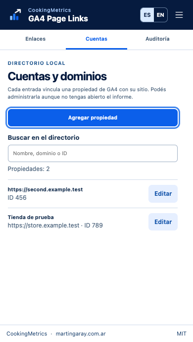
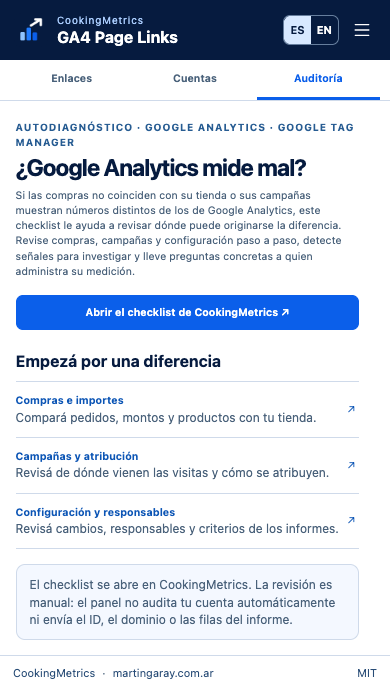

# GA4 Page Links

**Abrí la página que estás viendo en un informe de Google Analytics 4.** Esta extensión gratuita de [CookingMetrics](https://cookingmetrics.com/es/?utm_source=github&utm_medium=ga4-page-links) agrega un **↗** al lado de cada ruta reconocida. Guardás el dominio una vez por propiedad; después podés ir de una fila al sitio sin copiar y pegar. El texto original y las acciones del informe siguen disponibles.

**[Descargar la extensión para Chrome (ZIP)](https://github.com/martingaray/ga4-page-links/releases/latest/download/ga4-page-links.zip)** · [Guía en español](docs/AYUDA.md) · [English guide](docs/HELP.md) · [Licencia MIT](LICENSE)

Por [Martín Garay](https://www.martingaray.com.ar/?utm_source=github&utm_medium=ga4-page-links). Para equipos que revisan contenido, campañas o ecommerce en una o varias propiedades de GA4.

## Instalación

1. Usá **Chrome de escritorio 114 o posterior**. Descargá el ZIP del enlace de arriba y descomprimilo en una carpeta que vayas a conservar.
2. Abrí `chrome://extensions`, activá **Modo de desarrollador** y elegí **Cargar descomprimida**. Seleccioná la carpeta que contiene `manifest.json`.
3. Recargá las pestañas de Analytics que ya estaban abiertas. Hacé clic en **GA4 Page Links** desde el menú de extensiones de Chrome: se abre el panel lateral.
4. Abrí un informe con una dimensión de ruta. En **Enlaces**, verificá el ID de propiedad, ingresá el dominio de tu sitio y elegí **Guardar y aplicar**.

Se distribuye desde GitHub. Para instalarla no necesitás Node, credenciales ni acceso a la API de Analytics. Si venís de la versión 0.1, actualizá los archivos **en la misma carpeta**, recargá la extensión y después las pestañas de GA4. Así Chrome conserva la instalación y su directorio local. No la desinstales para actualizarla.

## Cómo se usa

| En el panel | Qué podés hacer |
| --- | --- |
| **Enlaces** | Configurá el dominio de la propiedad abierta, mirá la vista previa y, si corresponde, activá **Hostname por fila**. Al cambiar de propiedad, el panel sigue a la pestaña activa. |
| **Cuentas** | Agregá, buscá, editá o quitá entradas por **ID numérico de propiedad**. El nombre de referencia es opcional. Podés administrar otras propiedades sin abrir GA4. No se crean ni se eliminan cuentas en Google. |
| **Auditoría** | Abrí el autodiagnóstico de CookingMetrics en español o inglés. Podés entrar al checklist completo o ir directo a compras, campañas o configuración. |

Ejemplo: si el dominio guardado es `https://tienda.example` y la fila contiene `/zapatillas?color=azul`, **↗** abre `https://tienda.example/zapatillas?color=azul` en otra pestaña. Una propiedad sin dominio guardado no hereda el de otra.

  
  

## ¿Las compras no coinciden con tu tienda?

**[Empezá el autodiagnóstico gratuito de Google Analytics y Tag Manager](https://cookingmetrics.com/es/google-analytics-autodiagnostico/?utm_source=github&utm_medium=ga4-page-links#checklist)** · [Open the English self-check](https://cookingmetrics.com/google-analytics-self-check/?utm_source=github&utm_medium=ga4-page-links#checklist).

La guía te ayuda a contrastar pedidos, investigar diferencias entre campañas y revisar la configuración con evidencia. El panel abre la guía por elección tuya. No audita automáticamente una propiedad ni comparte lo que estás viendo en GA4.

## Qué se enlaza

- Dimensiones de ruta de página, ruta y clase de pantalla, página de destino y sus variantes con cadena de consulta, en español e inglés. Se procesan las filas presentes y las que aparezcan al paginar, ordenar o filtrar.
- No se enlazan totales, `(not set)`, clases de pantalla, rutas truncadas sin un valor completo ni rutas que puedan cambiar el dominio. Los enlaces conservan los parámetros de la fila y no agregan etiquetas de campaña.
- Si una propiedad abarca varios sitios, agregá **Hostname** a la misma tabla y activá el modo por fila. Con esa columna se saltean las filas sin un host válido; sin la columna se usa el dominio guardado. La extensión no agrega dimensiones ni cambia el informe.

## Privacidad y alcance

Los únicos permisos son `storage` (idioma y directorio local) y `sidePanel` (interfaz). El script de contenido se ejecuta solo en `https://analytics.google.com/*`. No usa permisos generales de pestañas, no guarda rutas ni métricas y no agrega telemetría. El enlace al checklist incluye solo etiquetas fijas que identifican la extensión o el README como origen. No incluye el dominio, el ID de propiedad ni valores del informe.

Las pruebas en Chrome usan tablas y propiedades ficticias. La compatibilidad con todas las pantallas actuales de GA4 depende de su HTML; un informe autenticado, Windows y Linux quedan pendientes de validación. La extensión no comprueba si el sitio de destino está en línea. [Ver qué se probó](docs/VALIDATION.md).

## Código y sugerencias

Este repositorio contiene el mismo código que vas a encontrar en el ZIP. Podés [informar un problema o proponer una mejora](https://github.com/martingaray/ga4-page-links/issues) o enviar un pull request. Si una dimensión no muestra enlaces, alcanza con su nombre, el idioma y una ruta ficticia; no hace falta compartir datos de tu cuenta de Analytics.

[CookingMetrics](https://cookingmetrics.com/?utm_source=github&utm_medium=ga4-page-links) · [martingaray.com.ar](https://www.martingaray.com.ar/?utm_source=github&utm_medium=ga4-page-links) · [Dimensiones de GA4](https://support.google.com/analytics/answer/12926732?hl=es) · [Panel lateral de Chrome](https://developer.chrome.com/docs/extensions/reference/api/sidePanel)
